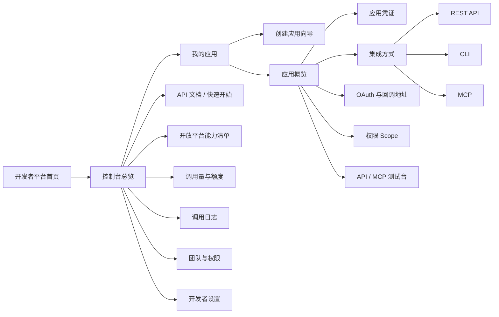
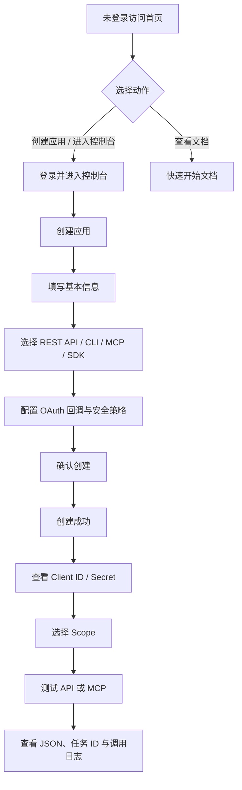

# 创客贴开放平台·开发者中心
需求标识：`DP-2610`
版本：MVP / 第一阶段
状态：待开发
面向端：桌面端 Web，推荐 1440 × 900
原型入口：`/developer-platform`

## 1. 产品定位

创客贴开放平台·开发者中心是面向个人开发者、企业技术团队、AI Agent 开发者和企业管理员的统一接入工作台。第一阶段先解决“应用注册—凭证获取—OAuth 授权—Scope 配置—REST API / CLI / MCP 接入—测试调用—调用观测—团队管理”的完整闭环，不建设完整应用市场、上架审核或在线代码 IDE。

设计目标：开发者第一次进入页面后，10 分钟内完成第一个 API 或 MCP 调用，并能回答：

1. 如何创建一个应用？
2. 如何安全获得凭证并完成授权？
3. 如何快速调用模板、素材、设计和 AI 能力？

参考 Canva Developer Portal 的应用、OAuth、MCP、CLI 和调用管理机制，仅借鉴开发者平台信息架构与产品机制，不复制其品牌、页面视觉或具体文案。

## 2. 信息架构

### 2.1 页面清单与层级

| 层级 | 页面 | 真实路由 / 页面位置 | 关键动作 |
| --- | --- | --- | --- |
| L0 | 开发者平台首页 | 创客贴开放平台·开发者中心 > 开发者平台首页 | 创建应用、进入控制台、查看文档 |
| L1 | 控制台总览 | 创客贴开放平台·开发者中心 > 控制台总览 | 查看应用、调用量、额度和最近活动 |
| L1 | 我的应用 | 创客贴开放平台·开发者中心 > 我的应用 | 搜索、筛选、查看、停用、创建应用 |
| L2 | 创建应用 | 创客贴开放平台·开发者中心 > 我的应用 > 创建应用 | 4 步向导注册应用 |
| L2 | 应用概览 | 创客贴开放平台·开发者中心 > 我的应用 > 应用概览 | 查看状态、凭证、调用量和快速操作 |
| L2 | 应用凭证 | 创客贴开放平台·开发者中心 > 应用凭证 | 查看、复制、轮换、撤销凭证 |
| L2 | 集成方式 | 创客贴开放平台·开发者中心 > 集成方式 | 配置 REST API / CLI / MCP |
| L2 | OAuth 与回调地址 | 创客贴开放平台·开发者中心 > OAuth 与回调地址 | 配置 redirect URI、PKCE 和组织授权 |
| L2 | 权限 Scope | 创客贴开放平台·开发者中心 > 权限 Scope | 按能力域选择权限 |
| L1 | API / MCP 测试台 | 创客贴开放平台·开发者中心 > API / MCP 测试台 | 在线执行工具、查看 JSON 和任务状态 |
| L1 | API 文档 / 快速开始 | 创客贴开放平台·开发者中心 > 快速开始文档 | 查看 REST API、CLI、MCP 步骤与代码 |
| L1 | 开放平台能力清单 | 创客贴开放平台·开发者中心 > 开放平台能力 | 对照 HTTP 接口、SDK、回调事件、参数和原始来源 |
| L1 | 调用量与额度 | 创客贴开放平台·开发者中心 > 调用量与额度 | 查看趋势、成功率、额度和限流 |
| L1 | 调用日志 | 创客贴开放平台·开发者中心 > 调用日志 | 追踪请求、响应、错误和任务 |
| L1 | 团队与权限 | 创客贴开放平台·开发者中心 > 团队与权限 | 邀请成员、改角色、组织授权、审计 |
| L1 | 开发者设置 | 创客贴开放平台·开发者中心 > 开发者设置 | 通知、安全、资源入口 |

## 3. 页面流程图

### 3.1 五条核心用户流程

| 流程 | 点击路径 | 结果 |
| --- | --- | --- |
| 创建第一个应用 | 首页 → 创建应用 → 基本信息 → 集成方式 → OAuth → 确认创建 → 应用概览 → 应用凭证 | 获取 Client ID 和只显示一次的 Client Secret |
| 首次接入 MCP | 应用概览 → 集成方式/MCP → 复制 Server URL → 配置 OAuth → 选择 Scope → 测试连接 → 搜索模板 | MCP 连接成功并能返回模板结果 |
| 首次调用 API | 应用概览 → API 文档 → 选择工具 → 打开测试台 → 填写参数 → 执行请求 | 返回 JSON、请求 ID、耗时和复制代码 |
| CLI 接入 | CLI 文档 → 复制安装命令 → `ckt login` → `ckt api` → `tasks.get` | 在终端完成同步或异步调用 |
| 企业管理员授权 | 团队与权限 → 待处理组织授权 → 查看 Scope / 数据范围 / 积分影响 → 同意授权 → 设置额度 | 完成组织级授权并写入审计日志 |

## 4. 角色与权限矩阵

| 能力 | 所有者 | 管理员 | 开发者 | 只读成员 | 财务/额度管理员 |
| --- | --- | --- | --- | --- | --- |
| 查看应用、文档、测试结果 | ✓ | ✓ | ✓ | ✓ | ✓ |
| 创建/编辑应用 | ✓ | ✓ | ✓ | — | — |
| 查看和复制凭证 | ✓ | ✓ | ✓ | — | — |
| 重新生成/撤销凭证 | ✓ | ✓ | — | — | — |
| 配置 OAuth / Scope / MCP | ✓ | ✓ | ✓ | — | — |
| 执行 API / MCP 测试 | ✓ | ✓ | ✓ | — | — |
| 查看调用日志 | ✓ | ✓ | ✓ | ✓ | ✓ |
| 导出调用日志 | ✓ | ✓ | ✓ | — | ✓ |
| 邀请/移除成员 | ✓ | ✓ | — | — | — |
| 修改成员角色 | ✓ | ✓ | — | — | — |
| 通过组织授权 | ✓ | ✓ | — | — | — |
| 设置调用额度/预警 | ✓ | ✓ | — | — | ✓ |
| 查看审计日志 | ✓ | ✓ | — | ✓ | ✓ |
| 删除应用 | ✓ | — | — | — | — |

## 5. 功能需求

### 5.1 开发者平台首页

#### 目标

让未登录用户理解开放平台能做什么，并把用户导向“创建应用、看文档、进入控制台”三个动作。

#### 内容与交互

- 首屏展示产品价值：通过 REST API、CLI、MCP 将创客贴设计能力接入自己的产品。
- 展示三种接入方式：
  - REST API：后端系统、服务端集成。
  - CLI：脚本、批处理和本地开发。
  - MCP：AI Agent、自然语言工作流。
- 提供“创建第一个应用”“进入控制台”“查看快速开始”按钮。
- 提供 API 文档、MCP 文档、官方 GitHub、SDK 和示例入口。
- 中文优先，右上角预留英文入口。
- 首页明确展示 4 步快速开始：创建应用、获取凭证、连接工具、测试调用。

#### 状态

- 未登录：展示首页，不展示真实组织数据。
- 文档加载失败：保留三种能力卡片，显示“文档暂时无法加载，请稍后重试”。
- 语言切换中：保留当前页面结构，显示轻量 loading。

### 5.2 控制台总览

- 左侧固定导航；顶部显示组织切换、生产/开发环境、通知、帮助和个人账号。
- 数据卡片：今日调用量、活跃应用、本月额度消耗、平均成功率。
- 快速开始进度：创建应用、获取凭证、配置接入、测试调用。
- 展示最近应用、最近活动、额度环和待处理提醒。
- 没有应用时，快速开始区直接引导创建第一个应用。

### 5.3 应用列表

- 列表字段：应用名称/图标、应用类型、所属组织、接入方式、状态、最近调用、创建时间、操作。
- 支持搜索应用名称或 ID、状态筛选、创建时间排序。
- 操作：查看、编辑、停用、删除；停用和删除均需二次确认。
- 状态：运行中、已停用、草稿。
- 空状态需要解释创建应用的收益并提供主按钮“创建第一个应用”。
- 应用停用后保留历史日志；停用应用不能生成新的 Access Token。

### 5.4 创建应用向导

#### 第一步：填写基本信息

- 必填：应用名称。
- 可选：Logo、应用描述、所属组织。
- 应用类型：个人应用、企业应用、内部应用。
- 应用用途：内容创作、企业系统、AI Agent、批量生产、其他。
- 应用名称重复时提示并阻止下一步。

#### 第二步：选择集成方式

- 可多选：REST API、CLI、MCP、SDK。
- 每种方式展示：适用用户、能力范围、所需凭证、是否需要 OAuth、是否需要企业审核。
- 至少选择一种接入方式。

#### 第三步：配置授权信息

- OAuth 回调地址、域名白名单、Webhook 地址。
- 开发环境地址、生产环境地址。
- 启用 PKCE、启用组织级授权。
- 生产环境回调地址必须使用 HTTPS；localhost 仅允许开发环境。

#### 第四步：确认创建

- 展示应用名称、类型、用途、集成方式、OAuth 回调地址和默认 Scope。
- 安全提示：Secret 只显示一次，不能提交到前端、GitHub 或公开代码仓库。
- 创建成功后展示成功状态，并提供“查看凭证”“配置权限”“开始测试”三个下一步动作。

### 5.5 应用概览

- 头部展示应用名称、图标、状态、应用 ID、类型、所属组织和当前环境。
- 数据：已授权用户数、今日调用量、本月额度消耗、平均响应时间。
- 快速操作：查看凭证、配置权限、配置 OAuth、测试 API、查看 MCP 配置、查看文档。
- 最近调用展示时间、调用方式、工具、请求 ID、状态、耗时。
- 应用创建成功后，展示一次性成功提示并优先引导进入凭证页。

### 5.6 凭证管理

凭证类型：Client ID、Client Secret、Access Key、Secret Key、Access Token、Refresh Token。

- 开发环境和生产环境分开管理。
- Client ID 可复制；Secret 默认隐藏，仅在生成后显示一次。
- 支持复制、备注、设置过期时间、重新生成、撤销。
- 重新生成前必须二次确认旧 Secret 会立即失效。
- 撤销前必须提示影响范围和当前使用中的服务。
- 展示最后使用时间、有效/过期/已撤销状态。
- Secret 过期、凭证泄露风险和额度不足均以高优先级安全提示展示。

### 5.7 集成方式

#### REST API

- API Base URL：`https://api.chuangkit.com/v1`。
- 鉴权：OAuth 2.0 / Bearer Token。
- 请求示例、返回示例、错误码和限流规则。
- 默认限流：60 req/min；超出返回 429，并提供 Retry-After。
- 支持复制 curl、JavaScript、Python 示例。

#### CLI

- 安装命令、登录命令、初始化命令、查看工具命令、调用任务命令、查询任务命令。
- 支持 macOS、Windows、Linux 安装说明。
- JSON 输出可直接管道给 jq 或脚本。
- CLI Access Token 可撤销，登录和退出操作写入调用日志。

#### MCP

- MCP Server URL：`https://api.chuangkit.com/connect/v1/mcp`。
- 授权：OAuth 2.0 + PKCE；每个终端用户独立授权。
- 提供 MCP 客户端配置示例、支持工具列表、权限说明。
- 提供测试连接按钮，并展示连接中、成功、失败、授权失败状态。
- 提供 Claude、Cursor、Codex、ChatGPT 配置指引。
- MCP 不绕过用户权限；工具调用受用户 Scope、组织授权和额度限制。

### 5.8 开放平台能力清单

#### 目标

在开发者中心增加“开放平台能力”页面，把已有开放平台能力按 HTTP 接口、SDK、前端回调与规则集中整理，方便开发者按名称、参数和能力快速查看与对照。页面不是新的接口实现，只负责对已公开能力进行结构化索引，并保留原始资料来源。

#### 来源与范围

- 原始来源地址：<https://chuangkit.yuque.com/qltowx/openapi3.0/ln9rmy>。
- 当前资料整理出 38 个 HTTP 接口、10 类 SDK/接入方式、5 类前端回调或事件。
- 统一生产环境域名：`https://gw.chuangkit.com/openplatform`。
- 资料中仅有功能描述但没有完整 URL、请求参数和响应字段的图像处理 API、AI 画匠、AI 抠图、AI 智能设计、PicDoc、场景中心，只展示“资料提及但明细待补充”，不自行补充接口。

#### 页面结构与交互

- “接入能力”导航新增“开放平台能力”入口。
- 页面提供三个视图：HTTP 接口、SDK、回调与规则。
- HTTP 接口表必须逐条展示：分类、请求方法、接口地址、必填参数、可选参数/枚举、返回或用途、原始来源链接。
- SDK 表必须逐条展示：SDK/接入方式、版本要求、初始化必传参数、具体调用/方法、主要能力、原始来源链接。
- 回调与规则视图展示 `window.chuangkitComplete`、`window.chuangkitAddImg`、移动端 `postMessage`、图片回调、无限画布事件、关键返回字段和 SDK 通用签名规则。
- 支持关键词搜索接口地址、方法、SDK 名称、参数和能力描述；切换视图后保留搜索条件。
- 每条接口、SDK、回调、参数参考和规则区块均提供“原始来源”链接，链接统一指向上述语雀原始地址；不得将来源地址藏在页面底部或只保留一个总链接。
- SDK 视图补充模板编辑器关键参数、图片编辑器参数、我的空间参数和常用生产地址示例。

#### 具体能力范围

- HTTP 接口覆盖 Token、缩略图、下载、团队模板、用户、授权、素材、PSD、无限画布、官方模板、模板配置、营销日历、我的设计和模板收藏。
- SDK/接入方式覆盖模板编辑器 Web/移动端、小程序接入、模板中心 Web/移动端、专题页、营销日历、图片编辑器、我的空间和无限画布。
- 关键返回字段覆盖 Token、模板列表/详情、我的设计、下载历史、PSD 任务、素材、节日和授权。
- SDK 通用签名规则展示：非空参数转下划线字段名、按参数名 ASCII 升序、`key=value&...` 拼接、MD5、大写；API Token 签名规则单独提示以 Token 文档为准。

#### 验收标准

1. 在“接入能力”下可以进入“开放平台能力”，页面标题、入口和需求路径保持一致。
2. HTTP 接口视图默认展示 38 条接口，任意一条均能看到方法、地址、参数、用途和“原始来源”链接。
3. SDK 视图默认展示 10 条 SDK/接入方式，任意一条均能看到版本、初始化参数、方法、能力和“原始来源”链接。
4. 回调与规则视图能查看 5 类回调/事件、关键返回字段、签名规则和资料范围说明，并保留原始来源链接。
5. 搜索接口路径、参数、SDK 方法或能力描述时，结果数量和表格内容同步过滤；清空搜索后恢复完整清单。
6. 从需求列表打开“开放平台能力清单”需求说明时，能看到页面路径、具体需求点、验收标准和原始来源地址。

### 5.9 权限 Scope

按以下能力域分组：账号与组织、模板读取、素材读取、素材上传、设计读取、创建设计、编辑设计、导出设计、AI 图片生成、AI 商品图、品牌资产、评论与协作、删除和移动资源。

每个 Scope 展示：权限名称、描述、读/写/删除等级、是否需要用户确认、是否需要管理员授权、可能的积分/费用影响。

危险权限必须显示醒目标识：

- 消耗 AI 额度。
- 修改现有设计。
- 删除素材。
- 发布设计。
- 访问企业品牌资产。

### 5.10 API / MCP 测试台

采用三栏布局：工具列表、参数区、结果区。

- 工具列表：分类、搜索、工具名称、权限标签。
- 参数区：表单输入、JSON 编辑器、文件上传、图片预览、异步执行开关。
- 结果区：请求结果、返回 JSON、请求耗时、任务 ID、结果预览、错误信息、复制代码。
- MVP 示例：`templates.search`、`templates.get`、`assets.search`、`designs.create`、`ai.product-image`、`exports.create`、`tasks.get`。
- 所有执行结果生成 request ID；异步任务生成 task ID，并提示轮询工具。

### 5.11 调用量与额度

- 今日调用量、近 7 日调用趋势。
- REST API、MCP、CLI 调用次数。
- AI 积分消耗、失败率、平均响应时间、剩余额度、限流状态。
- 支持按应用、组织、工具筛选。
- 额度达到 80% 发送预警；达到 100% 后 AI 生成和批量导出暂停。
- 额度不足时需说明受影响的工具和恢复时间。

### 5.12 调用日志

字段：时间、应用、用户、组织、调用方式、工具名称、请求 ID、任务 ID、状态、响应耗时、额度消耗、错误码。

- 支持按时间、工具、状态筛选。
- 支持查看请求摘要、响应摘要、错误详情。
- 支持复制请求 ID、导出日志。
- 日志详情保持与应用、Scope、任务和额度的关联。

### 5.13 团队与权限

- 角色：所有者、管理员、开发者、只读成员、财务/额度管理员。
- 支持邀请成员、修改角色、移除成员、查看成员最近操作。
- 组织授权请求展示 Scope、数据范围、积分影响和申请应用。
- 管理员可同意授权、拒绝授权、设置组织额度。
- 所有角色变更、授权处理和额度调整写入审计日志。

## 6. 数据模型

### 6.1 应用 `developer_app`

| 字段 | 类型 | 说明 |
| --- | --- | --- |
| id | string | 应用 ID，如 `app_7N4K2P` |
| name | string | 应用名称 |
| logo_url | string | Logo 地址，可为空 |
| description | string | 应用描述 |
| app_type | enum | personal / enterprise / internal |
| purpose | enum | content / enterprise / agent / batch / other |
| organization_id | string | 所属组织 |
| status | enum | draft / active / disabled / deleted |
| environments | json | dev / production 配置 |
| integrations | json | rest / cli / mcp / sdk 开关 |
| created_by | string | 创建人 |
| created_at | datetime | 创建时间 |
| updated_at | datetime | 更新时间 |

### 6.2 凭证 `developer_credential`

| 字段 | 类型 | 说明 |
| --- | --- | --- |
| id | string | 凭证记录 ID |
| app_id | string | 所属应用 |
| environment | enum | development / production |
| credential_type | enum | client_id / client_secret / access_key / secret_key / access_token / refresh_token |
| secret_hash | string | Secret 只存哈希或加密值 |
| display_hint | string | 掩码展示信息 |
| expires_at | datetime | 过期时间，可为空 |
| last_used_at | datetime | 最后使用时间 |
| revoked_at | datetime | 撤销时间 |
| note | string | 凭证备注 |
| created_by | string | 创建人 |

### 6.3 OAuth 配置 `developer_oauth_config`

| 字段 | 类型 | 说明 |
| --- | --- | --- |
| app_id | string | 应用 ID |
| environment | enum | 环境 |
| redirect_uris | json | 回调地址列表 |
| allowed_domains | json | 域名白名单 |
| webhook_url | string | Webhook 地址 |
| pkce_enabled | boolean | 是否启用 PKCE |
| org_authorization_enabled | boolean | 是否允许组织级授权 |
| verification_status | enum | pending / verified / rejected |

### 6.4 Scope `developer_scope_binding`

| 字段 | 类型 | 说明 |
| --- | --- | --- |
| app_id | string | 应用 ID |
| scope_key | string | 如 `template:read` |
| access_level | enum | read / write / delete |
| user_confirm_required | boolean | 是否需要用户确认 |
| admin_approval_required | boolean | 是否需要管理员授权 |
| credit_cost | integer | 可能产生的积分消耗 |
| enabled | boolean | 是否启用 |

### 6.5 组织 `developer_organization`

| 字段 | 类型 | 说明 |
| --- | --- | --- |
| id | string | 组织 ID |
| name | string | 组织名称 |
| owner_id | string | 所有者 |
| quota_config | json | API、AI、导出额度 |
| alert_threshold | integer | 默认 80 |
| status | enum | active / suspended |

### 6.6 任务 `developer_task`

| 字段 | 类型 | 说明 |
| --- | --- | --- |
| id | string | 任务 ID |
| app_id | string | 应用 ID |
| tool_name | string | 工具名称 |
| request_id | string | 请求 ID |
| status | enum | queued / processing / succeeded / failed / canceled |
| input_json | json | 输入参数 |
| result_json | json | 结果 |
| result_url | string | 结果链接 |
| error_code | string | 错误码 |
| started_at | datetime | 开始时间 |
| finished_at | datetime | 完成时间 |

### 6.7 调用日志 `developer_call_log`

| 字段 | 类型 | 说明 |
| --- | --- | --- |
| request_id | string | 请求 ID，唯一 |
| task_id | string | 异步任务 ID，可为空 |
| app_id | string | 应用 ID |
| organization_id | string | 组织 ID |
| user_id | string | 授权用户 |
| channel | enum | rest / cli / mcp |
| tool_name | string | 调用工具 |
| status | enum | success / failed / processing |
| latency_ms | integer | 响应耗时 |
| credit_cost | integer | 额度消耗 |
| error_code | string | 错误码 |
| request_summary | json | 脱敏后的请求摘要 |
| response_summary | json | 脱敏后的响应摘要 |
| created_at | datetime | 调用时间 |

## 7. API / MCP 测试台交互说明

1. 用户进入测试台，默认选择 `templates.search`，右侧为空态提示“填写参数后执行请求”。
2. 工具选择后，页面根据工具 Schema 渲染参数表单；高级用户可切换 JSON 编辑器。
3. 点击执行后，按钮进入“执行中”，结果区展示请求 ID、耗时和额度占用。
4. 同步成功展示 JSON；同步失败展示错误码、错误原因和修复建议。
5. 异步工具展示 task ID、进度和轮询提示；完成后提供结果预览和结果链接。
6. 用户可以复制请求代码、复制 JSON、打开调用日志。
7. 权限不足时引导到 Scope 页面；额度不足时展示剩余额度和受影响工具；超出限流时展示 Retry-After。

## 8. 组件与状态说明

### 通用组件

- 组织切换器：显示当前组织、生产/开发环境。
- 状态标签：运行中、已停用、草稿、成功、失败、处理中、已授权、待授权。
- 安全提示：凭证、Secret、Scope、费用和危险操作统一使用橙/红色提示。
- 代码块：语法等宽展示、复制反馈、长内容滚动。
- 数据卡片：指标、趋势、额度百分比和说明。
- 二次确认弹窗：重新生成凭证、撤销凭证、停用应用、删除应用、管理员授权。

### 必须覆盖的状态

| 状态 | 页面示例 | UI 文案 |
| --- | --- | --- |
| 未登录 | 首页 | 登录后创建应用并进入控制台 |
| 空应用列表 | 我的应用 | 还没有应用，创建你的第一个应用 |
| 创建成功 | 应用概览 | 应用创建成功，Secret 只显示一次 |
| 字段校验错误 | 创建应用 | 请先填写应用名称 / 回调地址 |
| OAuth 授权中 | OAuth / MCP | 正在等待用户完成授权 |
| 授权成功 | OAuth / MCP | 授权成功，可以开始调用 |
| 授权失败 | OAuth / MCP | 授权失败，请检查回调地址和 Scope |
| Secret 已隐藏 | 凭证 | Secret 已隐藏 |
| Secret 已过期 | 凭证 | 当前凭证已过期，请重新生成 |
| MCP 连接成功 | MCP | 连接成功，已发现 7 个工具 |
| MCP 连接失败 | MCP | 连接失败，请检查 URL、OAuth 和网络 |
| API 调用成功 | 测试台 | 请求成功，已返回 JSON |
| API 调用失败 | 测试台 | 请求失败，查看错误码和修复建议 |
| 异步任务处理中 | 测试台 | 任务处理中，可使用 tasks.get 查询 |
| 异步任务成功 | 测试台 | 任务完成，打开结果 |
| 异步任务失败 | 测试台 | 任务失败，查看错误详情 |
| 额度不足 | 额度 / 测试台 | 当前额度不足，AI 生成和批量导出已暂停 |
| 超出限流 | 测试台 / 日志 | 请求过于频繁，请在 Retry-After 后重试 |
| 无权限 | 测试台 / Scope | 当前应用未开启该权限 |
| 应用已停用 | 应用概览 | 应用已停用，无法创建新授权 |
| 删除确认 | 应用列表 | 删除后应用、凭证和授权关系将失效 |
| 组织切换 | 顶部 | 已切换到：品牌增长组 |

## 9. 关键 UI 文案

- 首页主标题：把创客贴的设计能力，接入你的产品。
- 首页副标题：通过 REST API、CLI 和 MCP，把模板、素材、设计与 AI 生成能力融入企业系统和自然语言工作流。
- 控制台欢迎语：你好，赵文文。
- 创建应用主按钮：创建第一个应用。
- 凭证安全提示：Secret 只显示一次，请存放在安全的密钥管理系统中。
- MCP 连接成功：连接成功，已发现可用工具。
- 测试台空态：填写参数后执行请求。
- 额度预警：已使用 80% 额度，达到 100% 后 AI 生成和批量导出将暂停。
- 组织授权：请确认应用访问的数据范围与积分影响。

## 10. 埋点方案

| 事件名 | 触发时机 | 关键属性 |
| --- | --- | --- |
| `developer_home_view` | 首页曝光 | is_logged_in, locale |
| `developer_home_cta_click` | 点击首页 CTA | cta_name |
| `developer_app_create_start` | 进入创建应用 | source |
| `developer_app_create_step_view` | 向导步骤曝光 | step |
| `developer_app_create_submit` | 提交创建 | app_type, integrations, purpose |
| `developer_app_create_success` | 创建成功 | app_id, integrations, has_oauth |
| `developer_credential_view` | 查看凭证页 | app_id, environment |
| `developer_credential_copy` | 复制凭证 | credential_type, environment |
| `developer_credential_rotate_confirm` | 确认轮换 | credential_type, environment |
| `developer_scope_save` | 保存 Scope | app_id, scope_count, danger_scope_count |
| `developer_oauth_save` | 保存 OAuth | app_id, environment, pkce_enabled |
| `developer_mcp_connect_test` | 点击测试 MCP | result, client |
| `developer_playground_run` | 测试台执行 | tool_name, channel, async |
| `developer_playground_result` | 测试台返回 | tool_name, status, latency_ms, error_code |
| `developer_log_detail_view` | 查看日志详情 | request_id, status |
| `developer_org_authorization` | 管理员处理授权 | action, scope_count, quota |

## 11. 关键指标

- 创建应用完成率：完成创建的应用数 / 开始创建应用数。
- 首次授权成功率：首次发起 OAuth 的用户中成功获得授权的比例。
- 首次 API/MCP 调用成功率：首次执行工具且返回成功的应用比例。
- 首次调用耗时：从进入控制台到第一次成功调用的中位时长，目标 ≤ 10 分钟。
- API 错误率：失败请求 / 总请求，按工具、应用、组织拆分。
- MCP 连接成功率：MCP 连接成功 / 连接测试总数。
- 7 日留存开发者数：首次调用后第 7 天仍有调用行为的开发者数。
- 额度预警命中率：达到预警线且被成功通知的组织比例。

## 12. MVP、第二阶段与暂缓范围

### MVP（第一阶段）

- 首页、控制台总览、应用列表、4 步创建应用。
- 应用概览、凭证管理、OAuth 回调、Scope 配置。
- REST API、CLI、MCP 三种接入说明和复制示例。
- API/MCP 测试台的模板搜索、素材查询、设计创建、AI 商品图、导出和异步任务示例。
- 调用量、额度、调用日志、团队成员、角色权限和组织授权。
- 所有关键页面的空态、加载态、错误态和危险操作二次确认。

### 第二阶段

- 更多 API 工具与自动生成 SDK。
- Webhook 事件订阅、重试策略和回调投递记录。
- 应用版本、环境变量、团队 SSO、SCIM 和更细的组织策略。
- API Explorer 的 OpenAPI 导入、请求历史和自动生成代码。
- MCP 工具发现、Schema 差异检测和客户端安装引导。
- 额度套餐、账单、成本中心和按部门分摊。

### 暂缓

- 完整应用市场和第三方应用上架审核。
- 复杂商业结算系统。
- 完整在线代码 IDE。
- 完整设计编辑器。
- 全量 API 工具的实现页面。

## 13. 验收标准

1. 从首页进入控制台后，可完成创建应用、查看凭证、选择 Scope、打开测试台和查看调用日志的完整路径。
2. 创建应用包含 4 步向导，字段校验错误不会进入下一步；创建成功后能进入应用概览。
3. Client Secret 默认隐藏，生成后只显示一次；复制、轮换和撤销均有明确反馈与二次确认。
4. REST API、CLI、MCP 集成 Tab 均能展示可复制的真实接入示例，MCP 包含 Server URL、OAuth、客户端配置和连接测试。
5. Scope 页面按能力域展示权限，危险权限有明确风险和费用提示。
6. 测试台支持至少 7 个示例工具，成功、失败、异步处理中、额度不足、限流和无权限状态可被识别。
7. 调用量页面能查看趋势、成功率、响应时间、额度和限流；调用日志能定位 request ID、task ID、错误码和额度消耗。
8. 团队页面包含 5 类角色、成员邀请、角色修改入口、待处理组织授权和审计入口。
9. 需求目录中 DP-2610 主需求与 14 个页面级子需求按业务顺序展示，路径、需求说明、页面入口和验收标准一致。
10. 高保真桌面端原型在 1440 × 900 下可正常浏览，主操作不被需求标识、抽屉或弹窗遮挡。
